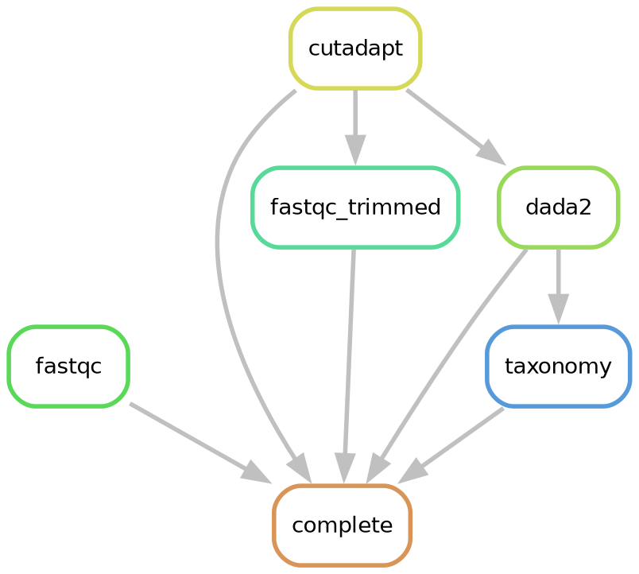

# 18S Metabarcoding Snakemake Pipeline

A configurable and reproducible bioinformatics workflow for
18S rRNA metabarcoding data analysis, from raw paired-end
sequencing reads to ASV inference and taxonomic assignment.

## 1. Project overview

This project was developed to strengthen my skills in
bioinformatics workflow automation, reproducible research
and NGS data analysis.

The workflow is based on real 18S rRNA metabarcoding data
from my Master's research project in Bioinformatics,
focused on protist communities associated with plants
and green roof ecosystems.

The main objective is to automate the processing of
paired-end sequencing data using Snakemake, R and Conda.

## 2. Workflow

The pipeline includes the following steps:

1. Raw read quality control using FastQC.
2. Primer removal using Cutadapt.
3. Quality control of trimmed reads using FastQC.
4. Quality filtering and error learning using DADA2.
5. Dereplication and ASV inference.
6. Paired-end read merging and chimera removal.
7. Generation of quality plots and read tracking reports.
8. Taxonomic assignment using the PR2 reference database.

### Workflow diagram



## 3. Tools and technologies

| Tool | Purpose |
|------|---------|
| Snakemake | Workflow management and automation |
| FastQC | Sequencing read quality control |
| Cutadapt | Primer removal |
| DADA2 | ASV inference and chimera removal |
| PR2 | Protist taxonomic reference database |
| R | Biological data processing and visualization |
| Conda | Software environment management |
| Graphviz | Workflow visualization |

## 4. Project structure

```text
18S-metabarcoding-snakemake/
├── Snakefile
├── README.md
├── config/
│   └── config.yaml
├── envs/
│   ├── fastqc.yaml
│   ├── cutadapt.yaml
│   └── dada2.yaml
├── scripts/
│   ├── script_dada2_nochim.R
│   └── script_taxonomie_PR2.R
├── docs/
│   └── pipeline_rulegraph.png
├── data/
├── references/
├── results/
└── logs/
```

## 5. Installation

### Requirements

- Linux or WSL2
- Conda or Miniconda
- Snakemake
- Graphviz (optional, for workflow visualization)

Create a dedicated Snakemake environment:

```bash
conda create -n snakemake -c conda-forge -c bioconda snakemake
conda activate snakemake
```

Create the tool-specific Conda environments:

```bash
snakemake --cores 2 --use-conda --conda-create-envs-only
```

## 6. Input data

Place paired-end FASTQ files in the data/ directory.

Expected naming convention:

```text
data/
├── SAMPLE1_R1_001.fastq.gz
├── SAMPLE1_R2_001.fastq.gz
├── SAMPLE2_R1_001.fastq.gz
└── SAMPLE2_R2_001.fastq.gz
```

Update the sample names in config/config.yaml to match
the FASTQ filenames.

The original research sequencing data are not distributed
with this repository.

## 7. Configuration

All major workflow parameters are centralized in:

```text
config/config.yaml
```

The configuration includes:

- Sample identifiers.
- Forward and reverse primers.
- DADA2 quality filtering parameters.
- Number of threads.
- PR2 reference database path.
- Taxonomic assignment parameters.

### DADA2 filtering parameters

The initial analysis used:

| Parameter | Value |
|-----------|-------|
| truncLen | 270, 250 |
| maxN | 0 |
| maxEE | 2, 2 |
| truncQ | 2 |
| rm.phix | TRUE |
| Threads | 2 |

These values should be adapted to the quality profiles
and expected amplicon length of each dataset.

## 8. Running the workflow

### Step 1: Preprocessing

Run quality control and primer removal:

```bash
snakemake preprocessing --cores 2 --use-conda
```

Inspect the FastQC reports before selecting the DADA2
filtering parameters.

### Step 2: ASV inference

Run the workflow up to non-chimeric ASV inference:

```bash
snakemake --cores 2 --use-conda
```

### Step 3: Complete workflow with taxonomy

Download the PR2 v5.0.0 SSU DADA2 reference database
from the official PR2 database distribution.

Place the reference file in:

```text
references/pr2_version_5.0.0_SSU_dada2.fasta.gz
```

Run the complete workflow:

```bash
snakemake complete --cores 2 --use-conda
```

Taxonomic assignment may require additional RAM.

### Dry-run

Check workflow dependencies without executing the tools:

```bash
snakemake complete --cores 2 --use-conda -n
```

## 9. Output files

The main outputs are:

| Output | Description |
|--------|-------------|
| FastQC HTML reports | Raw and trimmed read quality |
| Trimmed FASTQ files | Primer-free sequencing reads |
| seqtab.nochim.rds | Non-chimeric ASV abundance table |
| track.txt | Read retention across DADA2 steps |
| retention_track.pdf | Read retention visualization |
| ASV_length_distribution.pdf | ASV length distribution |
| ErrorLearning.pdf | DADA2 error model visualization |
| taxa_PR2.rds | Taxonomic assignment table |

## 10. Preliminary results

The initial analysis was successfully performed on two
18S metabarcoding samples from a Master's research dataset.

The analysis included:

- Primer removal and quality control.
- DADA2 quality filtering and error learning.
- ASV inference and paired-end read merging.
- Chimera removal.
- Read retention and ASV length visualization.

The analysis successfully generated a non-chimeric ASV
abundance table and quality control reports.

Original sequencing data and quantitative research results
are not publicly distributed in this repository.

## 11. Reproducibility and workflow validation

The workflow uses separate Conda environments for
software dependency management.

Snakemake manages file dependencies and supports
automatic workflow execution and provenance tracking.

The configurable workflow has been validated through
dry-runs for three execution targets:

- preprocessing
- all
- complete

The original preprocessing and DADA2 analysis were
successfully executed.

A full execution of the refactored workflow is still
required to confirm end-to-end reproducibility.

## 12. Current limitations

- Taxonomic assignment with PR2 encountered a memory
  allocation error on the local WSL2 environment.
- The taxonomy rule is implemented but has not yet
  been successfully executed.
- The final refactored workflow requires execution testing.
- Original research FASTQ files are not publicly distributed.

## 13. Future improvements

- Validate the complete workflow on an HPC cluster.
- Complete PR2 taxonomic assignment.
- Add a small public demonstration dataset.
- Improve resource management and execution profiles.
- Extend downstream ecological diversity analyses.

## 14. References

- Snakemake: https://snakemake.github.io/
- DADA2: https://benjjneb.github.io/dada2/
- Cutadapt: https://cutadapt.readthedocs.io/
- PR2 database: https://pr2-database.org/
- FastQC: https://www.bioinformatics.babraham.ac.uk/projects/fastqc/

## 15. Author

Stella Dorese SINDE NKWENA

Master's in Bioinformatics
Master's in Plant Biology

Interests: microbial ecology, environmental genomics,
NGS data analysis, reproducible workflows and data science.
